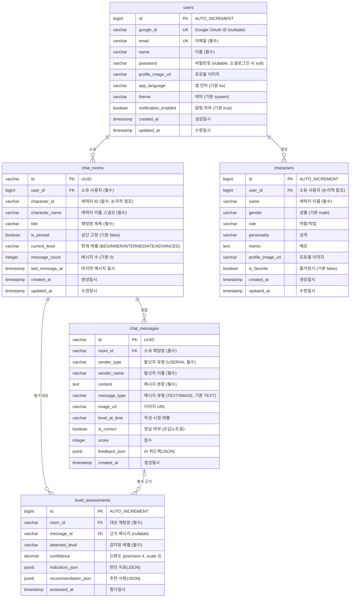

# Fluento ERD (데이터베이스 설계도)

> AI 영어회화 학습 서비스 Fluento의 엔티티 관계도(Entity-Relationship Diagram)
> 최종 업데이트: 2026-06-16
> 기준: `02-backend/src/main/java/com/fluento/domain` JPA 엔티티 (PostgreSQL)

---

## 1. ERD

---

## 2. 테이블 설명

| 테이블 | 설명 | PK 전략 |
|---|---|---|
| `users` | 서비스 사용자. Google 소셜 로그인 + 이메일/비밀번호 로그인 지원 | `bigint` IDENTITY |
| `characters` | 사용자가 만든 대화 상대 AI 캐릭터(역할/성격 설정) | `bigint` IDENTITY |
| `chat_rooms` | 사용자–캐릭터 간 채팅방. 현재 레벨·메시지 수 등 상태 보유 | `UUID` (String) |
| `chat_messages` | 채팅방의 개별 메시지. AI 피드백·점수·오답 여부 포함 | `UUID` (String) |
| `level_assessments` | 대화 기반 레벨 진단 이력. 신뢰도·지표·추천을 JSON으로 저장 | `bigint` IDENTITY |

---

## 3. 관계 및 제약조건

### 물리적 외래키 (JPA `@ManyToOne` + `@JoinColumn`)
- `chat_rooms.user_id` → `users.id` (필수)
- `chat_messages.room_id` → `chat_rooms.id` (필수)
- `level_assessments.room_id` → `chat_rooms.id` (필수)
- `level_assessments.message_id` → `chat_messages.id` (nullable)

### 논리적 참조 (FK 제약 없음, 애플리케이션 레벨 연결)
- `characters.user_id` → `users.id` — 단순 `Long` 컬럼으로 매핑(연관관계 매핑 아님)
- `chat_rooms.character_id` → `characters.id` — `varchar`로 보관하며 `character_name` 스냅샷을 함께 저장

> 참고: `chat_rooms`는 `(user_id, character_id)` 유니크 제약(`uk_chat_rooms_user_character`)을 둬 동일 사용자–캐릭터 채팅방 중복 생성을 방지합니다.

### 인덱스
- `chat_rooms`: `user_id`, `character_id`
- `chat_messages`: `room_id`, `created_at`
- `level_assessments`: `room_id`, `assessed_at`

---

## 4. Enum 값

| Enum | 사용 컬럼 | 값 |
|---|---|---|
| `Level` | `chat_rooms.current_level`, `chat_messages.level_at_time`, `level_assessments.detected_level` | `BEGINNER`, `INTERMEDIATE`, `ADVANCED` |
| `SenderType` | `chat_messages.sender_type` | `USER`, `AI` |
| `MessageType` | `chat_messages.message_type` | `TEXT`, `IMAGE` |
