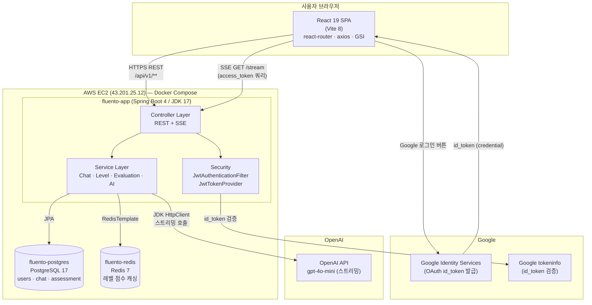
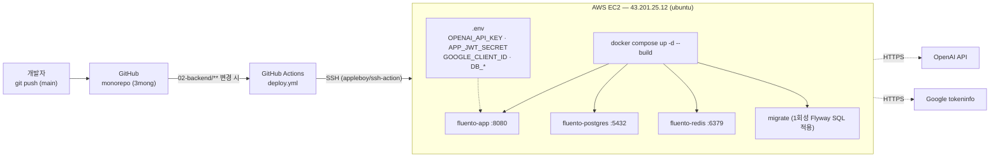
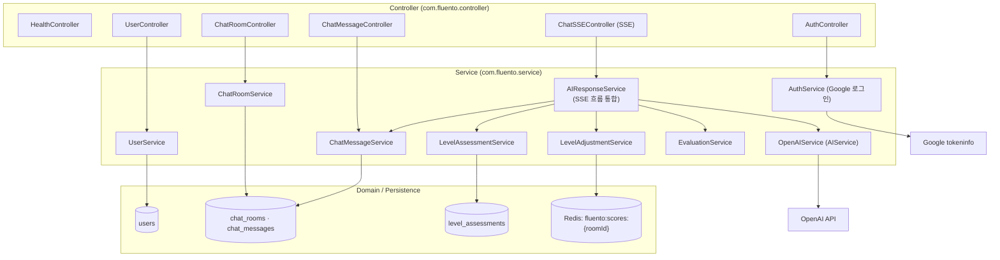
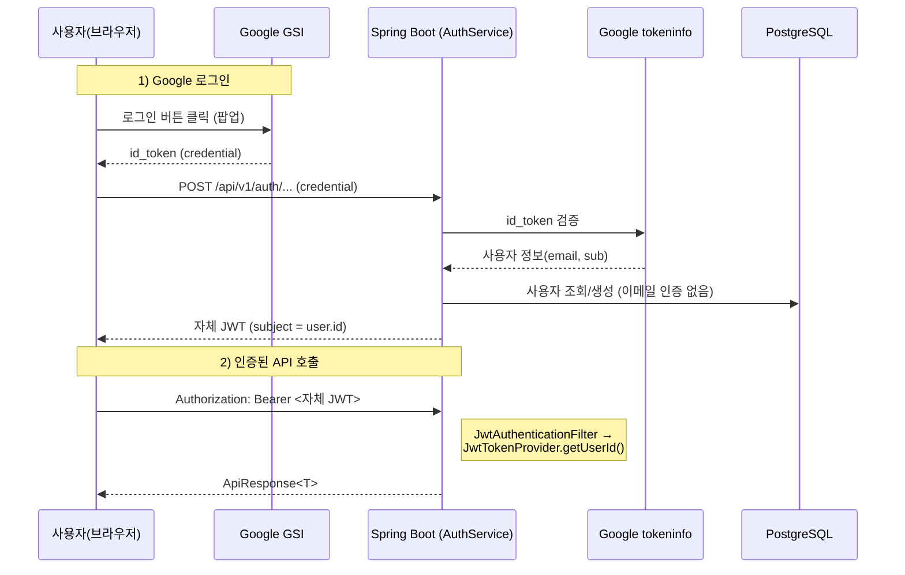
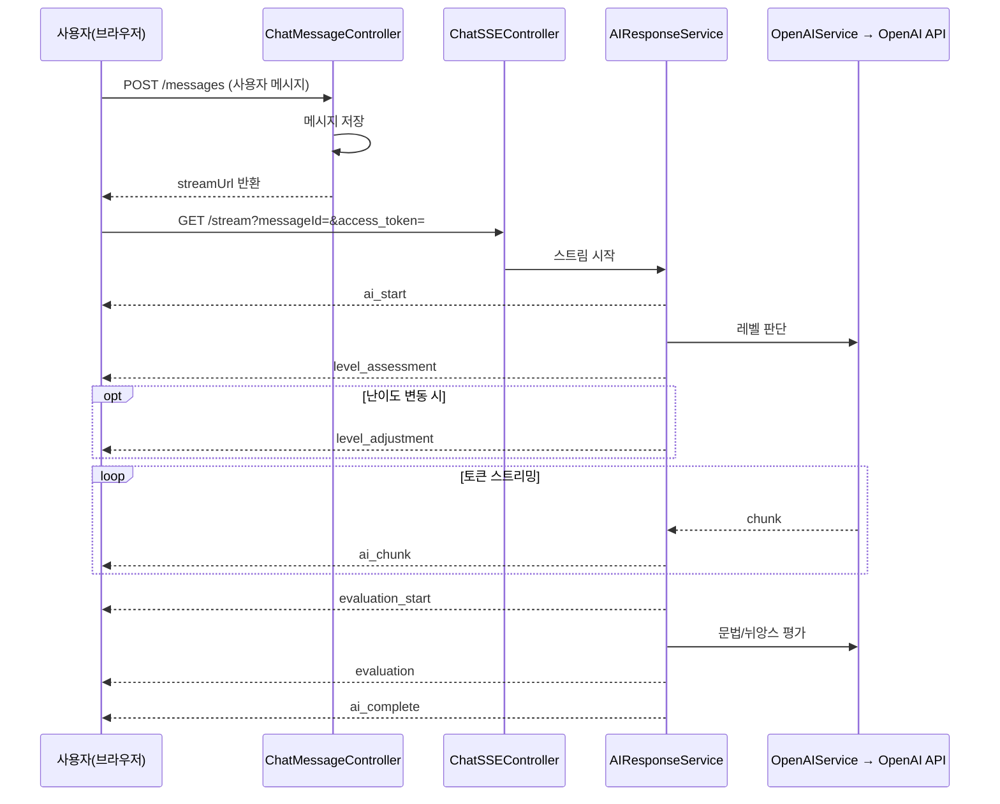

# Fluento 시스템 구성도

> AI 영어회화 학습 서비스 Fluento의 시스템 아키텍처 문서
> 최종 업데이트: 2026-06-16

---

## 1. 전체 시스템 구성도

---

## 2. 배포 / 인프라 구성도

**배포 흐름**
- `main` 브랜치에 `02-backend/**` 변경 푸시 → GitHub Actions가 EC2로 SSH 접속
- `git pull` → `docker compose down` → `docker compose up -d --build`
- 컨테이너: `fluento-app`, `fluento-postgres`, `fluento-redis`, 1회성 `migrate`
- 시크릿은 EC2의 `.env` 파일로 주입 (저장소에 커밋되지 않음)

---

## 3. 백엔드 계층 구조

---

## 4. 인증 흐름 (자체 JWT + Google 로그인)

> dev 프로필에서는 `DevSecurityConfig`가 모든 요청을 통과시키고 `googleId="dev-user"`로 자동 인증.

---

## 5. AI 응답 SSE 스트림 흐름

**난이도 조절 규칙** (`LevelAdjustmentService`, Redis 점수 추적)
- 올리기: 연속 3개 메시지 ≥ 90점
- 내리기: 연속 2개 메시지 ≤ 50점

---

## 6. 기술 스택 요약

| 영역 | 기술 |
|------|------|
| 프론트엔드 | React 19, Vite 8, react-router-dom 7, axios, @react-oauth/google, lucide-react |
| 백엔드 | Spring Boot 4.0 / Spring 7 / JDK 17, jjwt(자체 JWT) |
| 데이터 | PostgreSQL 17 (+ Flyway), Redis 7 |
| AI | OpenAI API `gpt-4o-mini` (스트리밍, JDK HttpClient) |
| 인증 | 자체 JWT + Google Identity Services (GSI) |
| 실시간 | SSE (Server-Sent Events) |
| 인프라 | AWS EC2 (43.201.25.12), Docker Compose |
| CI/CD | GitHub Actions → SSH 배포 (monorepo) |

> 참고: 과거 AWS Cognito / Bedrock(Claude 3.5 Sonnet v2)을 사용했으나,
> Cognito는 Google GSI 직접 검증으로, Bedrock은 OpenAI API로 각각 전환됨 (2026-06).
