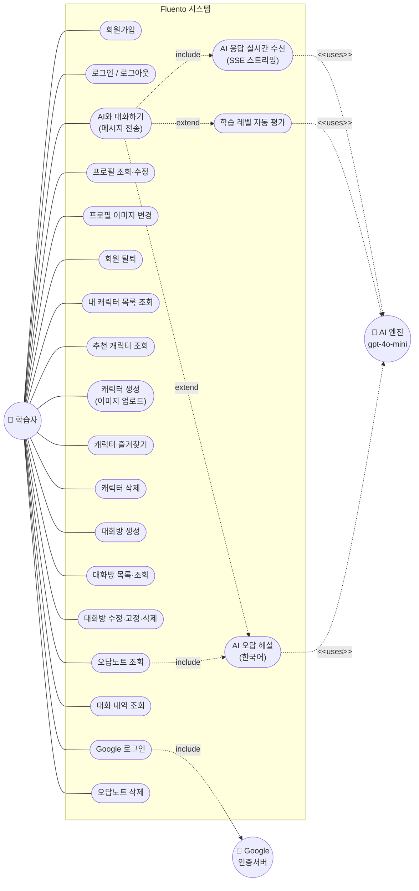

# Fluento 유스케이스 다이어그램 (Use Case Diagram)

> AI 영어회화 학습 서비스 Fluento의 액터-기능 관계도
> 최종 업데이트: 2026-06-16
> 기준: `02-backend/src/main/java/com/fluento/controller` REST 엔드포인트

---

## 1. 액터 (Actors)

| 액터 | 설명 |
| --- | --- |
| **학습자 (User)** | 서비스의 주 사용자. AI 캐릭터와 대화하며 외국어를 학습 |
| **Google 인증 서버** | 소셜 로그인(GSI) 처리 외부 시스템 |
| **AI 엔진 (OpenAI gpt-4o-mini)** | 대화 생성·레벨 평가·오답 해설을 담당하는 외부 시스템 |

---

## 2. Use Case 다이어그램

---

## 3. 유스케이스 설명

### 계정 / 인증
| ID | 유스케이스 | 엔드포인트 |
| --- | --- | --- |
| UC1 | 회원가입 (이메일 인증 없이 즉시 완료) | `POST /api/v1/auth/signup` |
| UC2 | 로그인 / 로그아웃 | `POST /api/v1/auth/login`, `/logout` |
| UC3 | Google 로그인 | `POST /api/v1/auth/google` |
| UC4 | 프로필 조회·수정 | `GET /api/v1/users/me`, `PUT /profile` |
| UC5 | 프로필 이미지 변경 | `PUT /api/v1/users/me/profile-image` |
| UC6 | 회원 탈퇴 | `DELETE /api/v1/users/me` |

### 캐릭터 (AI 대화 상대)
| ID | 유스케이스 | 엔드포인트 |
| --- | --- | --- |
| UC7 | 내 캐릭터 목록 조회 | `GET /api/v1/characters` |
| UC8 | 추천 캐릭터 조회 | `GET /api/v1/characters/recommended` |
| UC9 | 캐릭터 생성 (이미지 업로드) | `POST /api/v1/characters` |
| UC10 | 캐릭터 즐겨찾기 토글 | `PUT /api/v1/characters/{id}/favorite` |
| UC11 | 캐릭터 삭제 | `DELETE /api/v1/characters/{id}` |

### 대화방
| ID | 유스케이스 | 엔드포인트 |
| --- | --- | --- |
| UC12 | 대화방 생성 | `POST /api/v1/chat/rooms` |
| UC13 | 대화방 목록·조회 | `GET /api/v1/chat/rooms`, `/{roomId}` |
| UC14 | 대화방 수정·고정·삭제 | `PUT /{roomId}`, `/pin`, `DELETE` |

### 대화 (핵심 기능)
| ID | 유스케이스 | 엔드포인트 |
| --- | --- | --- |
| UC15 | AI와 대화하기 (메시지 전송) | `POST /api/v1/chat/rooms/{roomId}/messages` |
| UC16 | AI 응답 실시간 수신 (SSE) | `GET /{roomId}/stream` |
| UC17 | 대화 내역 조회 | `GET /{roomId}/messages` |
| UC18 | 학습 레벨 자동 평가 | `GET /{roomId}/level` |

### 오답노트
| ID | 유스케이스 | 엔드포인트 |
| --- | --- | --- |
| UC19 | 오답노트 조회 | `GET /api/v1/wrong-answers` |
| UC20 | AI 오답 해설 (한국어) | (UC19 조회 시 포함) |
| UC21 | 오답노트 삭제 | `DELETE /api/v1/wrong-answers/{id}` |

---

## 4. 관계 (Relationships)

- **include**: `Google 로그인 → Google 인증서버`, `AI와 대화하기 → SSE 실시간 수신`, `오답노트 조회 → AI 오답 해설`
- **extend**: `AI와 대화하기` 시 `학습 레벨 자동 평가`·`AI 오답 해설`이 부가적으로 트리거됨
- **uses (외부 시스템)**: SSE 수신·레벨 평가·오답 해설은 모두 **AI 엔진(gpt-4o-mini)** 을 호출
